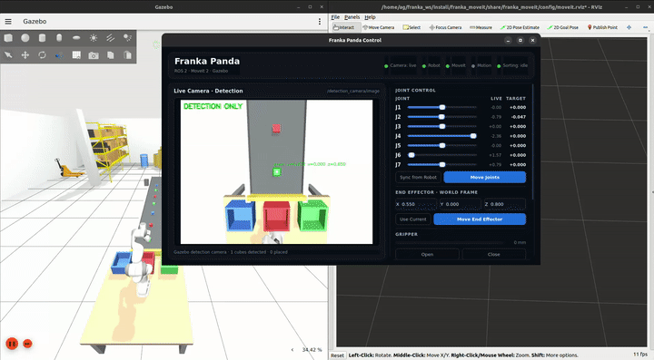

# Franka Panda ROS 2 Simulation & Colour Sorting

A ROS 2 Humble simulation and pick-and-place project for the **Franka Emika Panda 7-DoF robotic arm**. The workspace integrates Gazebo Sim, `ros2_control`, MoveIt 2, an overhead RGB camera, OpenCV colour detection, and a PySide6 control GUI.

The robot detects **red, green, and blue cubes**, picks them from a conveyor, and places them into their corresponding colour-matched bins.

> **Simulation only:** This project does not include the Franka hardware driver or physical robot integration.

## Demo



**[Watch the full colour-sorting demonstration (WebM)](media/franka_sorting.webm)**

## Robot & Simulation

| Real Franka Panda | Panda Robot in RViz |
|:---:|:---:|
|  |  |

## Features

- **Robot simulation:** Franka Panda 7-DoF arm in Gazebo Sim.
- **Motion planning:** MoveIt 2 planning and collision-aware trajectory execution.
- **Robot control:** `ros2_control` arm and gripper controllers.
- **Colour sorting:** OpenCV-based detection of red, green, and blue cubes.
- **Pick-and-place:** Automated cube picking and placement into matching bins.
- **Conveyor control:** Stops the conveyor at the pick station and resumes after the cube is removed.
- **Camera integration:** Live overhead camera feed bridged from Gazebo to ROS 2.
- **Desktop GUI:** PySide6 interface for camera viewing, joint control, Cartesian targets, gripper commands, and sorting controls.
- **Verification:** Checks Gazebo object poses to verify grasping and placement.

## System Architecture

```text
Gazebo Sim
    |
    +-- Franka Panda + ros2_control
    |
    +-- Conveyor + RGB Cubes + Sorting Bins
    |
    +-- Overhead RGB Camera
              |
              v
       ROS 2 Image Bridge
              |
              v
      OpenCV Colour Detection
              |
              v
       Pick-and-Place Logic
              |
              v
          MoveIt 2
              |
              v
      Arm + Gripper Controllers
              |
              v
      Verify Grasp and Placement
```

## Requirements

- Ubuntu 22.04
- ROS 2 Humble
- Gazebo Sim 6 and `ros_gz_sim`
- `ros_gz_bridge`
- MoveIt 2
- `ros2_control` and ROS 2 controllers
- Python 3, OpenCV, NumPy, PyYAML, and PySide6

Install the required ROS packages:

```bash
sudo apt update
sudo apt install \
  ros-humble-moveit \
  ros-humble-ros2-controllers \
  ros-humble-ros-gz-sim \
  ros-humble-ros-gz-bridge \
  ros-humble-ign-ros2-control \
  ros-humble-tf2-ros \
  ros-humble-xacro \
  python3-opencv \
  python3-numpy \
  python3-yaml \
  python3-pyside6.qtwidgets
```

Install any additional dependencies required by the packages in your workspace using `rosdep`.

## Build

```bash
cd ~/franka_ws

source /opt/ros/humble/setup.bash

rosdep install --from-paths src --ignore-src -r -y

colcon build

source install/setup.bash
```

Run the workspace tests:

```bash
colcon test --event-handlers console_direct+
colcon test-result --verbose
```

## Quick Start

Launch the complete simulation:

```bash
cd ~/franka_ws

source /opt/ros/humble/setup.bash
source install/setup.bash

ros2 launch franka_bringup bringup.launch.py
```

The full launch starts the simulation, robot controllers, MoveIt 2, RViz2, and the sorting system and GUI as configured by the bringup launch file.

Sorting starts in detection-only mode. Press **Start Sorting** in the GUI or call the start service to enable robot movement.

### Headless Mode

Run without the Gazebo GUI or RViz2:

```bash
ros2 launch franka_bringup bringup.launch.py \
  use_gazebo_gui:=false \
  rviz:=false \
  start_gui:=false
```

## Sorting Controls

Start sorting:

```bash
ros2 service call /franka_sorting/start \
  std_srvs/srv/Trigger "{}"
```

Stop sorting:

```bash
ros2 service call /franka_sorting/stop \
  std_srvs/srv/Trigger "{}"
```

The sorting system detects coloured cubes, selects the corresponding destination bin, executes pick-and-place motions through MoveIt 2, and checks the Gazebo poses to verify placement.

## Useful ROS 2 Topics

| Topic | Purpose |
|---|---|
| `/detection_camera/image` | Raw camera image |
| `/franka_sorting/annotated_image` | Camera image annotated with detections |
| `/franka_sorting/detected_count` | Current detections in the pick area |
| `/franka_sorting/placed_count` | Number of cubes placed since startup |
| `/franka_sorting/status` | Sorting phase and result |
| `/joint_states` | Robot joint feedback |

Inspect available topics and nodes:

```bash
ros2 topic list
ros2 node list
ros2 action list
ros2 control list_controllers
```

## Workspace Packages

| Package | Responsibility |
|---|---|
| `franka_description` | Panda URDF/Xacro, meshes, Gazebo models, and warehouse world |
| `franka_controller` | Arm and gripper controller configuration |
| `franka_moveit` | MoveIt 2 planning configuration and RViz setup |
| `franka_sorting` | Colour detection and verified pick-and-place logic |
| `franka_gui` | Camera view and robot/sorting control interface |
| `franka_utils` | Supporting utilities, including conveyor control |
| `franka_bringup` | Integrated system launch |

## Troubleshooting

**Packages are not found**

```bash
source /opt/ros/humble/setup.bash
source ~/franka_ws/install/setup.bash
```

**Controllers are not active**

```bash
ros2 control list_controllers
```

Check that `joint_state_broadcaster`, `panda_arm_controller`, and `panda_hand_controller` are active.

**MoveIt cannot execute trajectories**

```bash
ros2 action list
```

Check that `/move_action` and `/panda_hand_controller/gripper_cmd` are available and that the controller configuration matches the action names.

**Camera feed is missing**

```bash
ros2 topic list | grep detection_camera
ros2 topic echo /detection_camera/image
```

Verify that Gazebo is running and that the camera bridge has started.

**Build errors after changing packages**

```bash
cd ~/franka_ws
colcon build
source install/setup.bash
```

If a clean rebuild is necessary, stop running nodes first and remove the workspace's `build`, `install`, and `log` directories before rebuilding.

## License

The project code, URDF/Xacro files, launch files, and documentation are released under the MIT License, subject to the terms of the repository's `LICENSE` file.

Third-party assets retain their original licenses. The Franka Panda meshes are licensed under Apache-2.0, and the real robot photograph is credited to Ims under CC BY-SA 4.0. See the relevant asset notices and source licenses for details.
